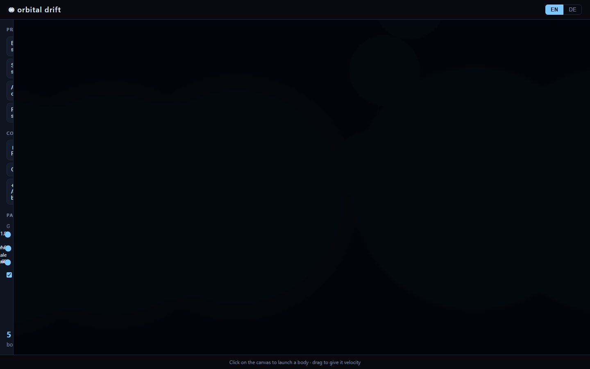
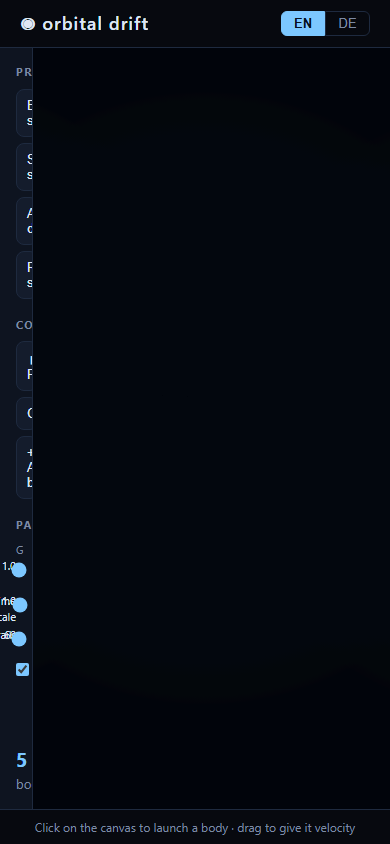

# Orbital Drift — N-Body Gravity Sandbox

An interactive gravity sandbox: spawn celestial bodies, tune gravitational constants, and watch colliding stars, binary systems and galaxy-like swarms emerge in real time on canvas.

<div align="center">


**[Live Demo](https://ruslanfridenli.github.io/orbital-drift/)** · **[Deutsch ↓](#-deutsch)**

</div>

---

## Screenshots






## Features

- Real-time N-body gravity simulation with softening
- One-click presets: binary star, solar system, accretion disc, random swarm
- Adjustable G, time scale and trail length
- Click anywhere to launch a new body
- Pause, reset and collision visualization
- Full English/German interface

## Local development

```bash
git clone https://github.com/ruslanfridenli/orbital-drift.git
cd orbital-drift
# open index.html in a browser, or serve statically:
npx serve .
```

No build step, no dependencies — pure static site.

---

## 🇩🇪 Deutsch

### Orbital Drift — N-Körper-Schwerkkraft-Sandbox

Eine interaktive Schwerkkraft-Sandbox: Himmelskörper spawnen, Gravitationskonstanten justieren und in Echtzeit kollabierende Sterne, Doppelsternsysteme und galaxieähnliche Schwärme beobachten.

### Funktionen

- Echtzeit-N-Körper-Simulation mit Softening
- Presets per Klick: Doppelstern, Sonnensystem, Akkretionsscheibe, Zufallsschwarm
- Anpassbare G, Zeitstrahl und Spurlänge
- Klick ins Bild startet einen neuen Körper
- Pause, Reset und Kollisionsvisualisierung
- Vollständige englische/deutsche Oberfläche

### Lokale Entwicklung

```bash
git clone https://github.com/ruslanfridenli/orbital-drift.git
cd orbital-drift
npx serve .
```

Reine statische Seite — kein Build-Schritt, keine Abhängigkeiten.

---

Made with care. Feedback welcome via issues.
